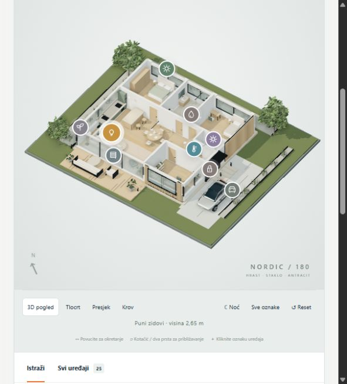

# Smart Home 3D

An interactive Three.js showroom for a 180 m² smart home: explore 25 simulated devices, switch between the house and tablet views, and try five automation scenarios.



## Try it locally

With Python 3 installed, run from this directory:

```sh
python -m http.server 8080 --bind 127.0.0.1
```

Open <http://127.0.0.1:8080/> in a WebGL-capable browser. No build step, API key, account or connected home hardware is required. Serve the files over HTTP rather than opening `index.html` directly.

## What to explore

- Orbit the scene, switch to the floor plan, cut away the walls or show the roof.
- Select a device to inspect lighting, shades, temperature, security and other simulated states.
- Use the scene buttons to see coordinated changes across the home.
- Switch to **Tablet / mobitel** for a dashboard using the same state.

The interface is in Croatian. Every device state is simulated. This is a visual concept, not a construction drawing, measurement system or estimate of energy savings.

## Source map

`state.js` holds the shared model; `model.js`, `nordic.js` and `materials.js` build the scene; `app.js` controls the house UI; `tablet.js` provides the dashboard. Three.js is vendored for local use.

## Rights and dependencies

Three.js retains its [MIT notice](vendor/THREE-LICENSE.txt). No general reuse license is granted for the original project code or Origin branding in this initial portfolio publication. Dependency licenses remain applicable.
